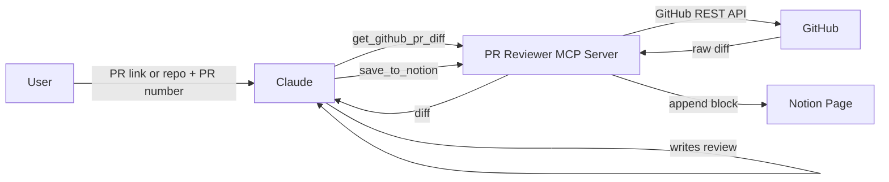

### Github PR(PULL REQUEST) Reviewer & Notion Sync MCP Server

# PR Reviewer MCP Server

An [MCP (Model Context Protocol)](https://modelcontextprotocol.io) server that lets an AI assistant such as Claude **review GitHub pull requests** and **save the review to Notion**.

You give the assistant a PR link or a repo and PR number. It fetches the diff through this server, writes a review (bugs, code quality, suggestions), and stores the summary in a Notion page.

Build as a [Anthropic Academy MCP Course](https://academy.claude.com/couses/introduction-to-model-context-protocol),applying MCP tools to automate Github PR review and save it to Notion page.

---

## What It Does

1. **Fetches a PR diff** from GitHub using the GitHub API.
2. **Lets the AI review the code** (the review is written by the AI model, not by the server).
3. **Saves the review summary** to a Notion page so it is kept in one place.

The server only provides tools. The reasoning and review writing is done by the connected AI assistant.

---

## Architecture



Flow:

1. The user asks Claude to review a PR.
2. Claude calls `get_github_pr_diff` and receives the raw diff.
3. Claude writes the review summary.
4. Claude calls `save_to_notion` with the summary.

---

## Tools

### `get_github_pr_diff`

Fetches the raw diff of a specific GitHub pull request.

| Parameter | Type | Description |
|-----------|------|-------------|
| `owner` | string | GitHub username or organization that owns the repo |
| `repo` | string | Repository name |
| `pull_number` | integer | Pull request number |

**Returns:** the raw diff text of the PR.

### `save_to_notion`

Appends the review summary as a block to the configured Notion page.

| Parameter | Type | Description |
|-----------|------|-------------|
| `review_summary` | string | The review text to save |

**Returns:** a confirmation that the block was added.

> The Notion page is set once through configuration. It is not passed as a tool parameter.

---

## Tech Stack

- **Protocol:** Model Context Protocol (MCP)
- **Language:** Python
- **GitHub access:** GitHub REST API (pull request diff)
- **Notion access:** Notion API (append block children)

---

## Project Structure

Adjust this to match your repository.

```
pr-reviewer-mcp/
├── server.py          # MCP server and tool definitions
├── requirements.txt   # Dependencies
├── .env.example       # Template for environment variables
├── .gitignore
└── README.md
```

---

## Getting Started

### 1. Clone the repository

```bash
git clone https://github.com/<your-username>/<your-repo>.git
cd <your-repo>
```

### 2. Create a virtual environment

```bash
python -m venv venv
source venv/bin/activate        # Windows: venv\Scripts\activate
```

### 3. Install dependencies

```bash
pip install -r requirements.txt
```

### 4. Set up environment variables

```bash
cp .env.example .env
```

Fill in the values (see below).

---

## Configuration

| Variable | Description |
|----------|-------------|
| `GITHUB_TOKEN` | GitHub personal access token used to read PR diffs |
| `NOTION_TOKEN` | Notion integration token |
| `NOTION_PAGE_ID` | ID of the Notion page where reviews are appended |

> Use the variable names your code actually reads. Update this table if they differ.

### Getting the GitHub token

1. Go to **GitHub → Settings → Developer settings → Personal access tokens**.
2. Create a token with read access to the repositories you want to review (`repo` scope for private repos, `public_repo` for public ones).
3. Paste it into `GITHUB_TOKEN`.

### Getting the Notion token and page ID

1. Create an integration at [notion.so/my-integrations](https://www.notion.so/my-integrations) and copy its token.
2. Open the target Notion page, click **Share**, and invite your integration so it can write to the page.
3. Copy the page ID from the page URL and paste it into `NOTION_PAGE_ID`.

> **Security:** Never commit your real `.env` file or tokens.

---

## Connect to Claude

Add the server to your MCP client configuration. Example for Claude Desktop:

```json
{
  "mcpServers": {
    "pr-reviewer": {
      "command": "python",
      "args": ["/absolute/path/to/server.py"],
      "env": {
        "GITHUB_TOKEN": "your_github_token",
        "NOTION_TOKEN": "your_notion_token",
        "NOTION_PAGE_ID": "your_notion_page_id"
      }
    }
  }
}
```

Restart the client. The `pr-reviewer` connector and its two tools should now appear.

---

## Usage Examples

Ask Claude:

- "Review PR #1 in `owner/repo`."
- "Fetch the diff for PR 12 of `owner/repo`, review it for bugs, and save the summary to Notion."
- "Check this PR for code quality issues: `https://github.com/owner/repo/pull/3`"

---

## BUILT UNDER THE GUIDANCE OF:
[ANTHROPIC ACADEMY-MCP Course](https://academy.claude.com/courses/introduction-to-model-context-protocol)

---

